# Diagram cases

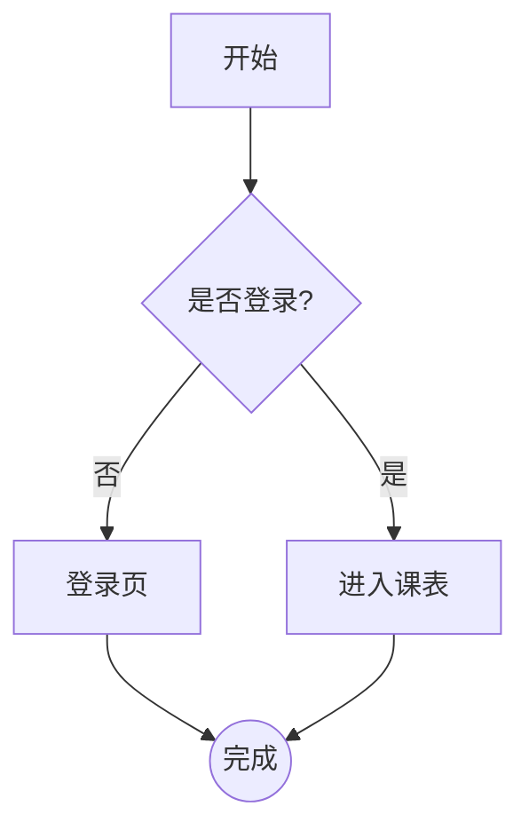

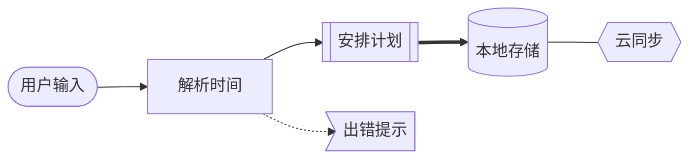

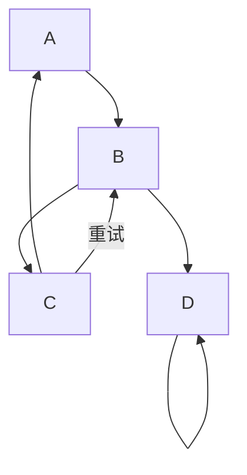

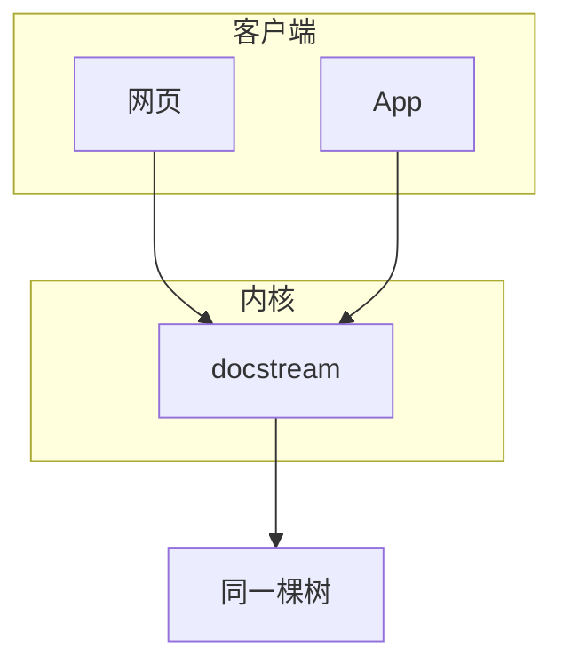

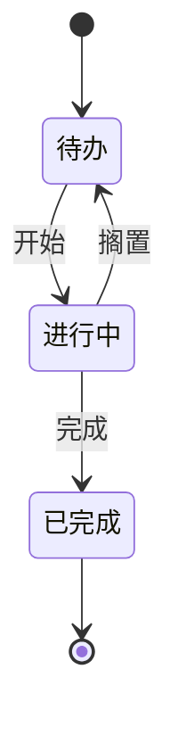

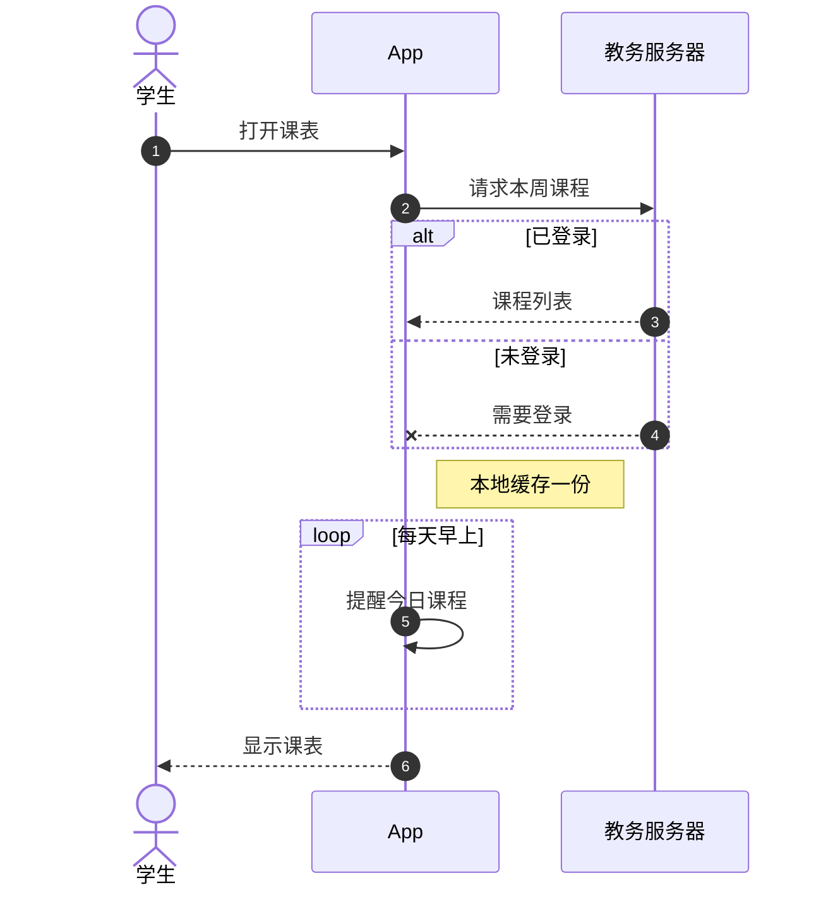

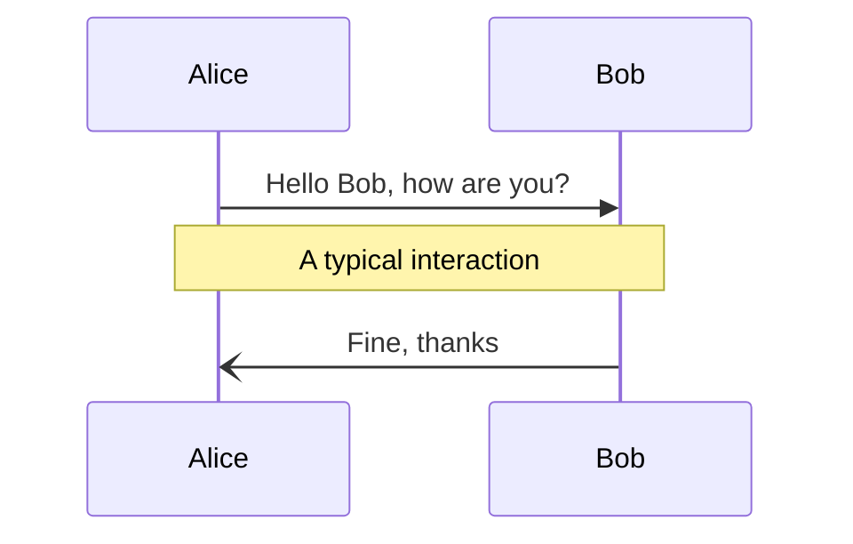

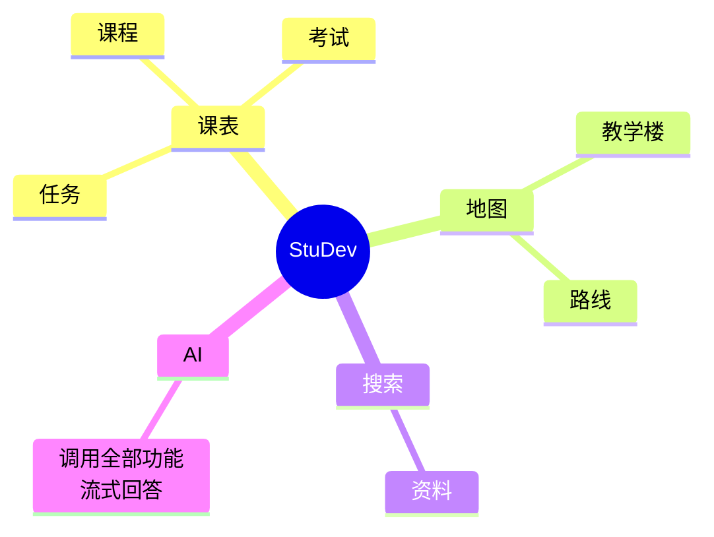

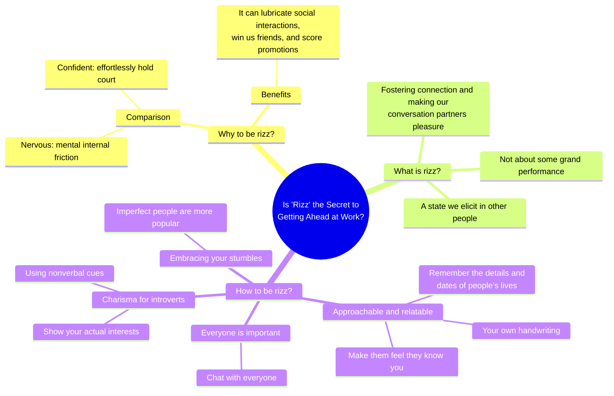

```mermaid
gantt
    dateFormat HH:mm
    axisFormat %H:%M
    title 11月13日 周五
    section 不可动
    健身 Gym           :07:30, 90m
    计组课/实验(同时段) :09:50, 95m
    毛概               :13:45, 95m
    中国文化概论        :15:35, 95m
    Essay              :21:00, 30m
    section 可用空档
    空闲               :11:25, 140m
    空闲               :17:10, 230m
```

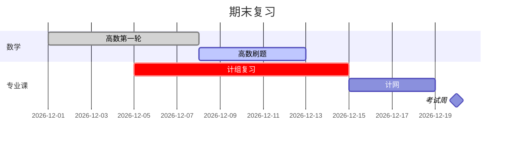

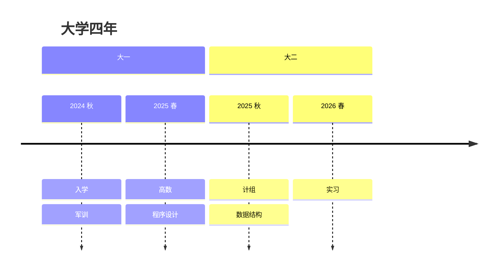

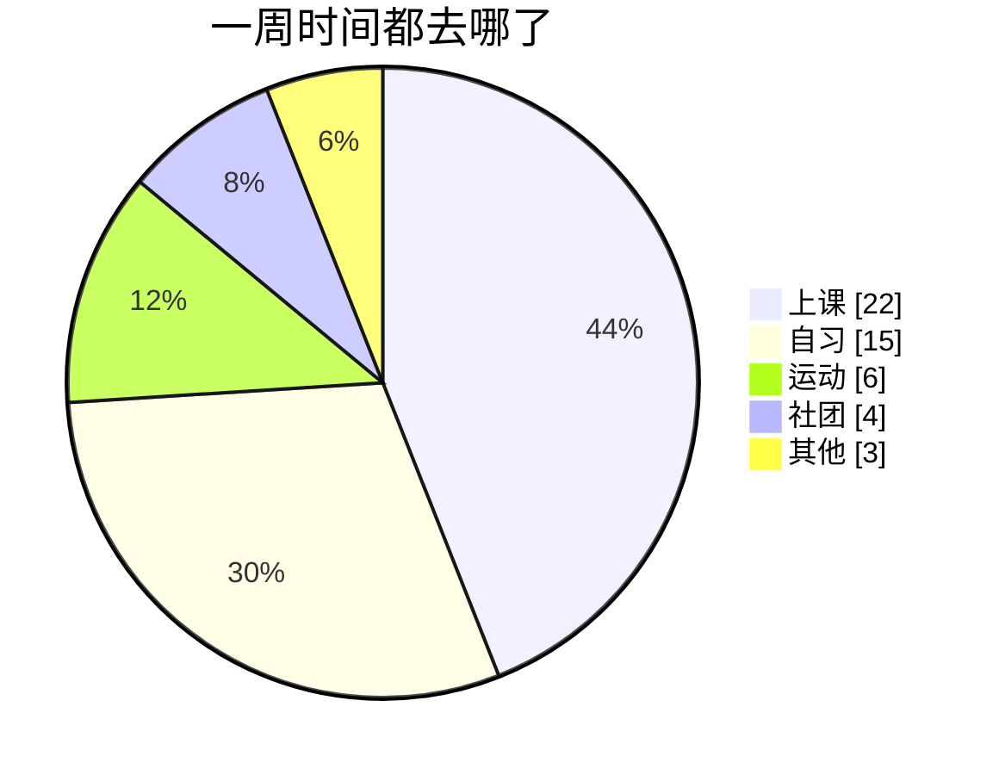

```mermaid
gantt
    dateFormat YYYY-MM-DD HH:mm
    axisFormat %H:%M
    title 11月14日 周六 安排与空档
    section 上午
    嵌入式手机终端开发技术 教4-208 :crit, a2, 2026-11-14 08:00, 3h25m
    section 午后
    空档 午饭午休 :a3, 2026-11-14 11:25, 1h35m
    写错的一行 :a4, 明天下午, 很久
    空档 教三自习可用 :a5, after a3, 4h30m
```
